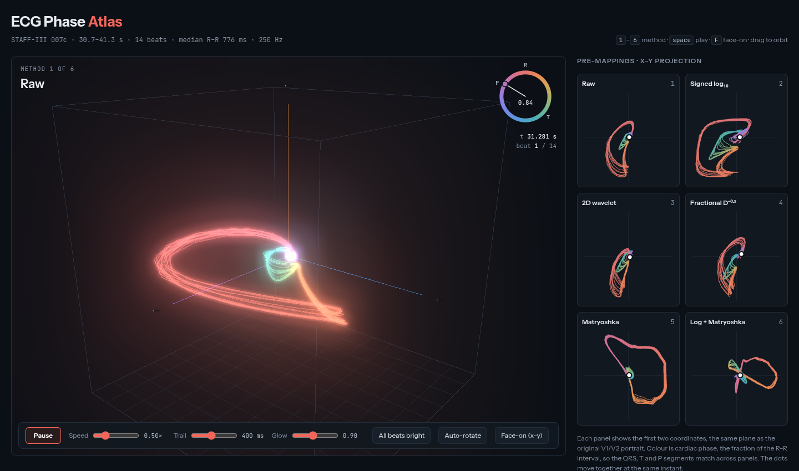
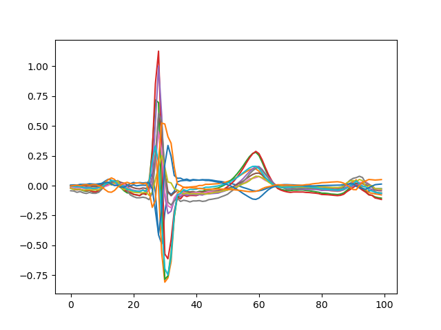
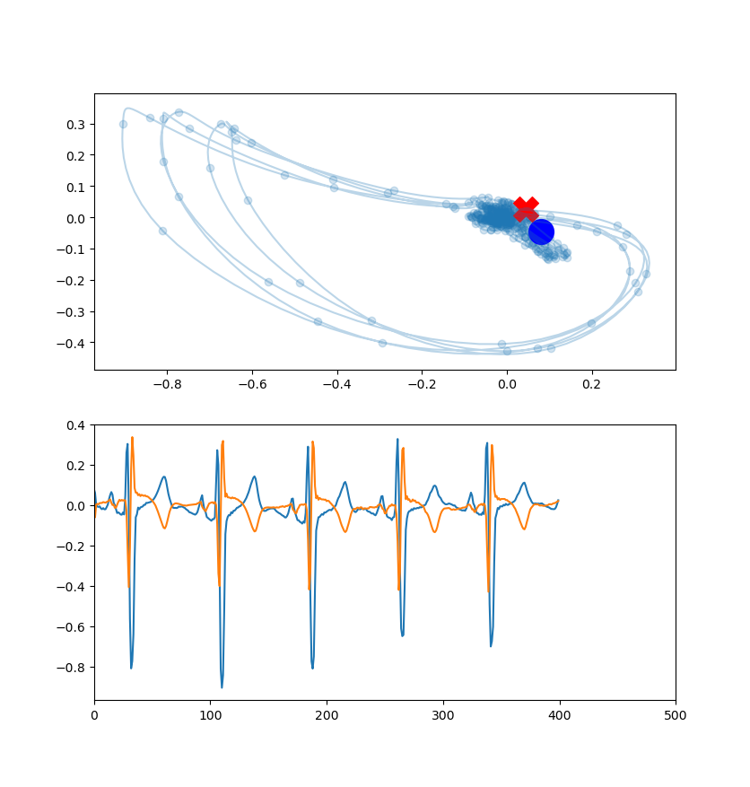
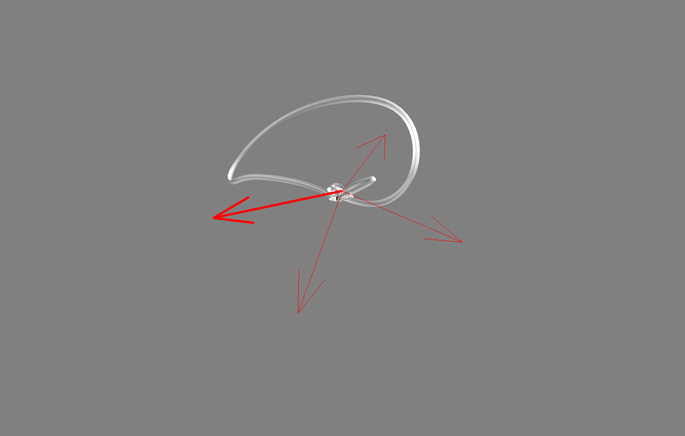
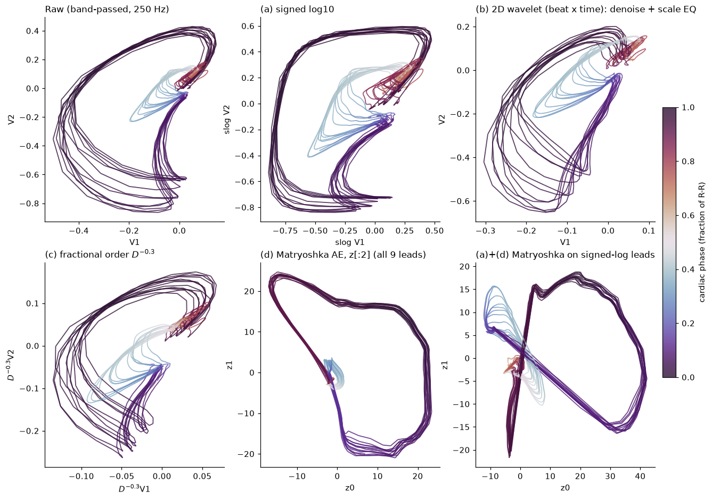
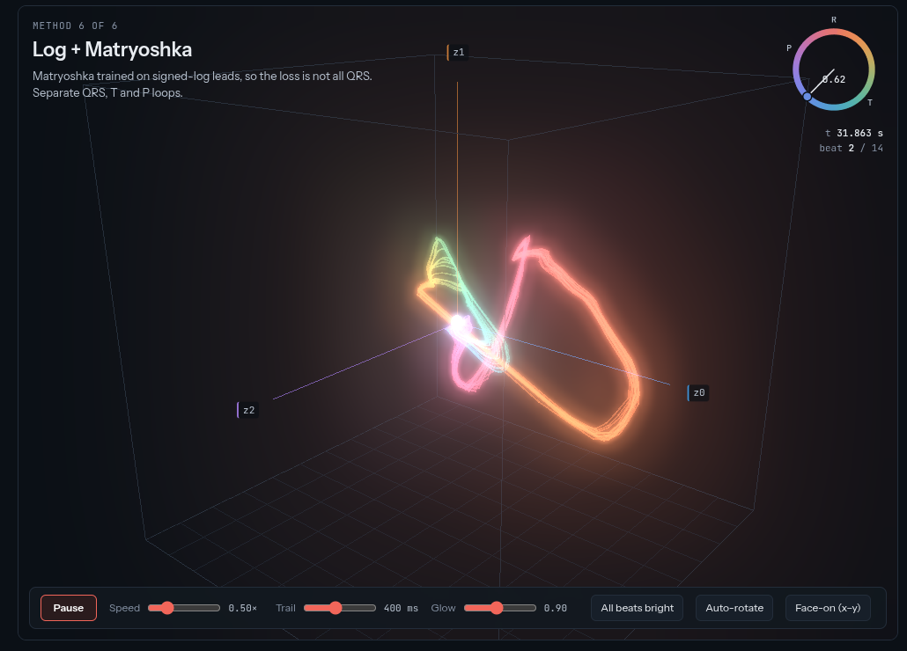
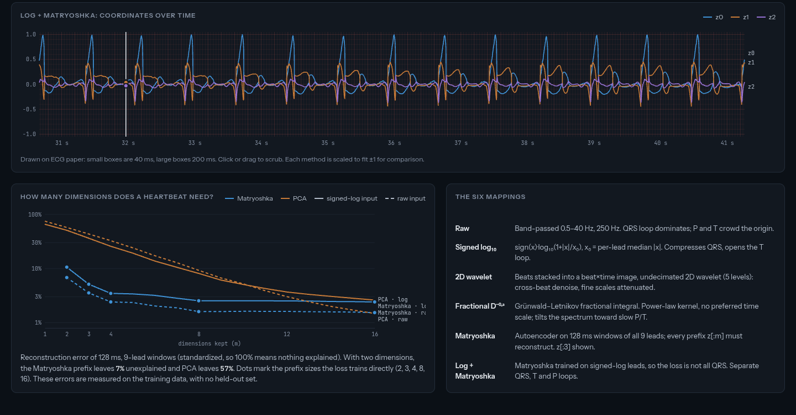
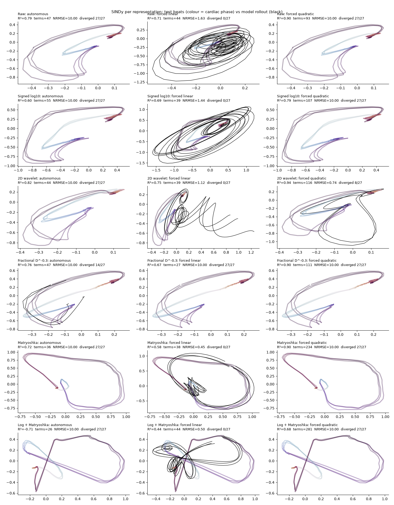
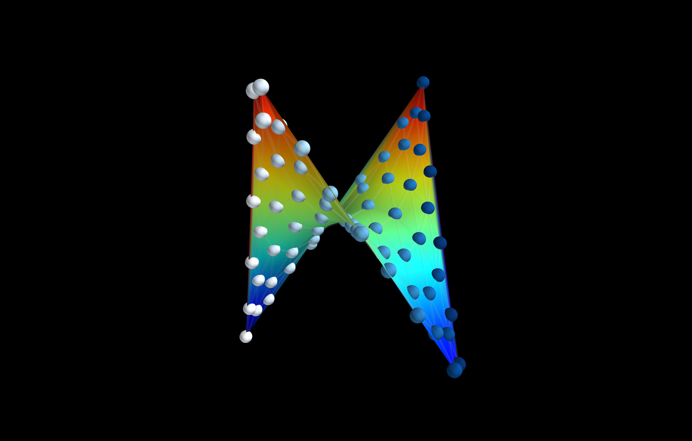

# ECG Tensors and Visualization
Author: Vineet Tiruvadi 2019

A fun library I made during my IM rotation at Grady/Emory. It's meant to help visualize the learning process with ECGs, particularly with an emphasis on seeing the traditional ECG timetraces in a more modern, dynamical systems perspective. Maybe this will rely on other control theory-related repos I've got setup...

## Contents
- [Dataset](#dataset)
- [Phase portraits](#phase-portrait) (the original 2D/3D views)
- [Multiscale pre-mappings](#multiscale-pre-mappings): signed log, 2D wavelet, fractional order, Matryoshka
- [ECG Phase Atlas](#ecg-phase-atlas): interactive three.js + d3 page
- [Standalone web app](#standalone-web-app): the Atlas as a Vite site, with pixel-parity tests
- [SINDy in each representation](#sindy-in-each-representation)
- [Mechanical-electrical syncytium](#mechanical-electrical-from-scratch)

## Dataset
We'll use the PhysioNet.org STAFFIII database. Record `007c` (no previous MI) is the default; `013c` (previous MI) is in `focus_data/` too.

## Calculating augmented leads
The first step is to take the 9 channels from the STAFFIII database and compute our augmented leads. It's pretty straightforward to do, so we do it.

> Known issue: `calculate_augmenteds` in `ecg_tensor.py` builds aVF/aVR/aVL from channels 0 and 1, which are V1 and V2, not leads I and II (channels 6 and 7). The newer code below doesn't use the augmented leads.

## Phase portrait
ECGs are multiple measurements of a single underlying process: the heart beating.
As it beats, it exhibits *patterns* that cardiologists have spent a lot of time mapping in detail.
Those details, while important, can likely be simplified greatly by looking at the data in a different way.
The engineering and physics fields give us a great way to view them: the phase space.
In this space, we can see how variables relate to each other and how they change with respect to each other.
With a very simple reframing of the data, we can see patterns emerge much more obviously.

An example of the phase space between channel V1 and V2 is displayed below

### 3D Phase portrait
Why not plot it in 3d? That's much cooler

## Multiscale pre-mappings
The raw V1/V2 portrait is dominated by the QRS loop; P and T collapse into a blob at the origin.
`multiscale.py` rebalances the scales before plotting. Every mapping works on the band-passed
(0.5–40 Hz), 250 Hz signal, which on its own already fixes the jagged 100 Hz loops of the original.

| Mapping | Function | What it does |
|---|---|---|
| (a) Signed log₁₀ | `signed_log` | `sign(x)·log10(1+\|x\|/x0)`, x0 = per-lead median \|x\|. Compresses QRS, opens the T loop. Simplest and most effective. |
| (b) 2D wavelet | `beat_stack`, `wavelet2d` | Beats stacked into a (beat × time) image per lead; undecimated 2D wavelet (`swt2`, 5 levels). Cross-beat denoising plus attenuation of the fine within-beat scales where the QRS lives. |
| (c) Fractional order | `gl_fractional_derivative` | Grünwald–Letnikov fractional integral/derivative. Power-law kernel with no preferred time scale; order −0.3 tilts the spectrum toward the slow P/T waves. |
| (d) Matryoshka | `matryoshka_embed` | Autoencoder on 128 ms windows of all 9 leads where every latent prefix z[:m] (m = 2, 3, 4, 8, 16) must reconstruct, so (z0, z1) is the best learned 2D plane. `return_recon=True` gives reconstruction error per prefix size. |
| (a)+(d) | | Matryoshka trained on signed-log leads, so the loss isn't all QRS: separate QRS, T and P loops. |

Also in the module: `load_ecg` (band-pass + decimate), `find_r_peaks` (multi-lead energy envelope).

`python multiscale_phase.py` draws all six side by side, coloured by cardiac phase (fraction of the R–R interval):

## ECG Phase Atlas
An interactive page that puts all six mappings in one place
([`atlas/ecg_phase_atlas_artifact.html`](atlas/ecg_phase_atlas_artifact.html), self-contained, opens in a browser;
also published as a private Claude artifact).

**Features**
- **3D phase portrait (three.js):** 14 beats as thick lines coloured by cardiac phase, bloom glow, orbit/zoom, auto-rotate, and a face-on (x–y) button.
- **Comet trail:** a glowing playhead moves through the beats in real time with a fading trail; speed, trail length and glow are sliders.
- **Morphing:** switching mapping animates every beat from one representation to the next.
- **Phase clock:** a cyclic colour ring marking R, T and P with a needle at the current point in the beat; it doubles as the colour legend.
- **Small multiples (d3):** the x–y plane of all six mappings, with dots that move together at the same instant. Click a panel, or press 1–6, to switch.
- **ECG-paper trace:** the selected mapping's three coordinates on 40 ms / 200 ms paper; click or drag to scrub, hover for values.
- **"How many dimensions does a heartbeat need?":** reconstruction error vs dimensions kept, Matryoshka vs PCA, raw vs signed-log input. With two dimensions the Matryoshka prefix leaves 7% unexplained and PCA 57% (training data, no held-out set).
- Keyboard: `1`–`6` mapping, `space` play/pause, `F` face-on.

Regenerate the data with `python export_atlas.py` (writes `web/public/ecg_data.json`).

## Standalone web app
`web/` is the Atlas as a plain Vite site (no framework). The rendering code is the artifact's code
unchanged; three.js 0.160.0 and d3 7.9.0 are pinned to the same versions, and `index.html`
reproduces the artifact host's base styles, so it looks and behaves the same.

    cd web
    npm install
    npm run dev      # local dev server
    npm run build    # static site in dist/ (relative paths, host anywhere)
    npm test         # pixel-parity tests vs the artifact (system Chrome)

`tests/parity.spec.js` (Playwright + pixelmatch) runs the same script against the artifact and the
app under a frozen clock and compares full-page screenshots: method switching, mid-morph,
face-on, toggles, sliders, trace scrubbing and tooltips, at desktop and phone widths.
All 10 scenarios pass with at most 13 differing pixels.

## SINDy in each representation
`sindy_multiscale.py` fits sparse dynamical models (pysindy) to the 3D state of each mapping:
train on 20–90 s of record 007c, test on 27 beats from 90–110 s, time measured in beats.

- **autonomous:** x' = f(x), cubic library
- **forced linear:** x' = A x + B u(θ), u = cos kθ, sin kθ (k = 1..6) of the cardiac phase
- **forced quadratic:** quadratic library on [x, u]

| Representation | Forced linear: rollout NRMSE (diverged) | Forced quadratic | Autonomous |
|---|---|---|---|
| Raw | 1.63 (0/27) | diverged 27/27 | diverged 27/27 |
| Signed log | 1.44 (0/27) | diverged 27/27 | diverged 27/27 |
| 2D wavelet | 1.13 (0/27) | 0.74 (8/27) | diverged 27/27 |
| Fractional | diverged 27/27 | diverged 27/27 | 14/27 diverged |
| Matryoshka | **0.45** (0/27) | diverged 27/27 | diverged 27/27 |
| Log + Matryoshka | **0.50** (0/27) | diverged 27/27 | diverged 27/27 |

The Matryoshka latents are the only representation where the heartbeat behaves like a stable,
phase-driven linear system that reproduces the beat's shape. Output: `imgs/sindy_multiscale.png`,
`sindy_results.json`; a full run takes about 30 minutes.

## Mechanical-Electrical (from scratch)
The next step is to build up a cardiomyocyte syncitium from scratch and try to get it to generate electrical signals in a forward model

## Requirements
Python: `numpy scipy matplotlib wfdb PyWavelets scikit-learn torch pysindy` (plus `mayavi` for
`ecg_tensor.py`'s 3D views). Web app: Node 18+.

Fetal heart rate and labor (CTG) work lives in the separate TocoPhase repository.
